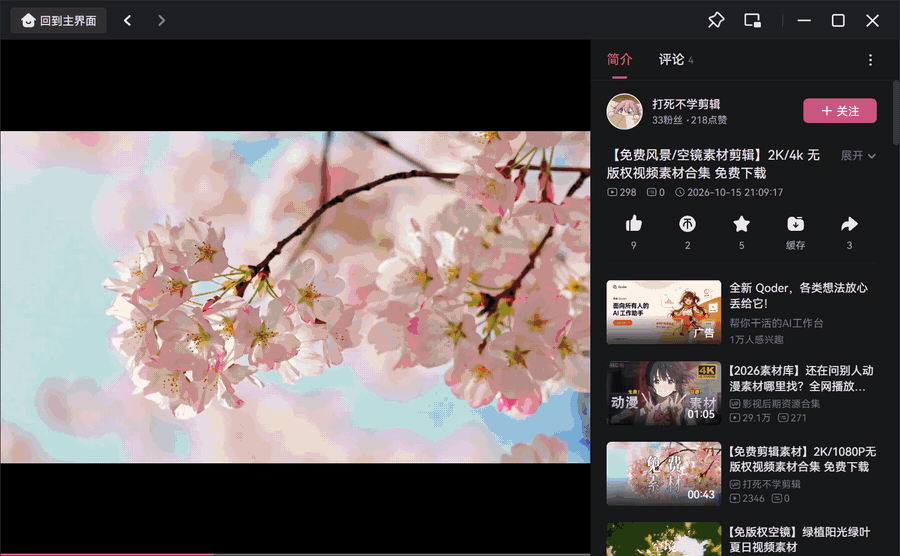
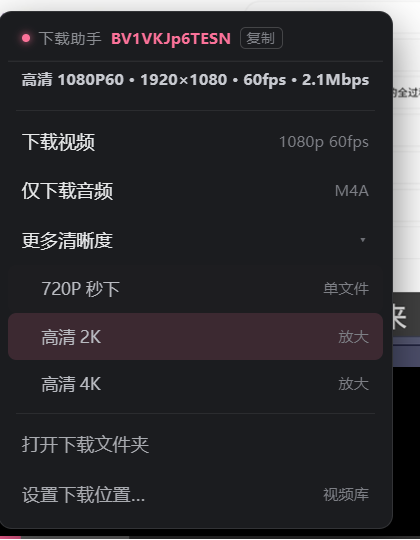
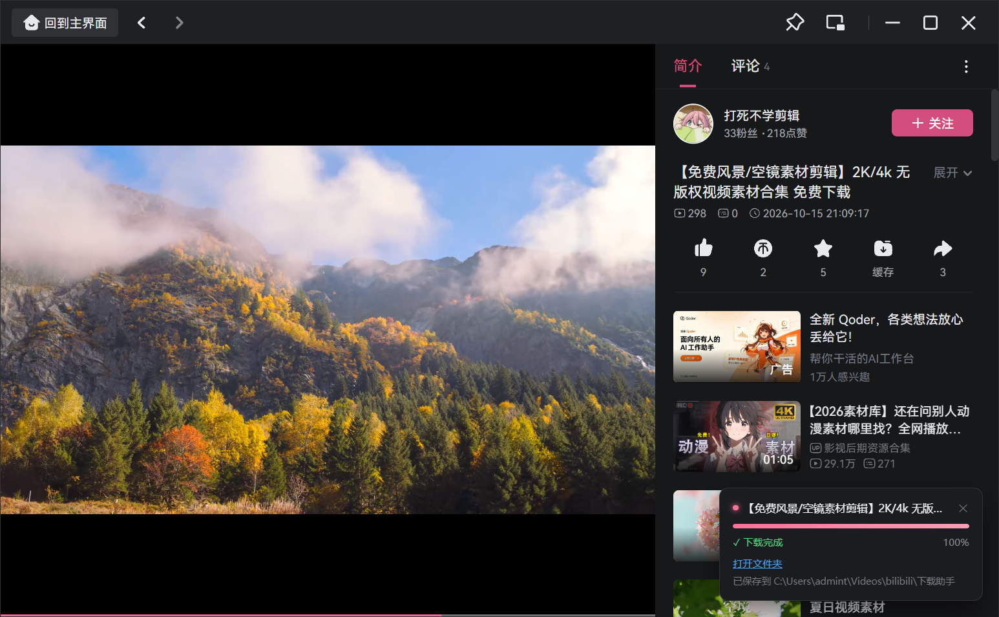
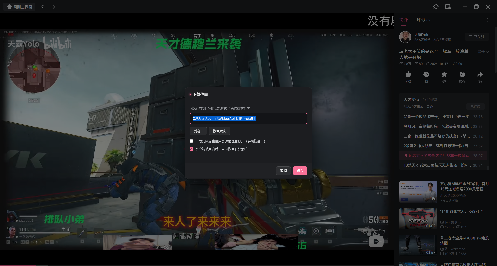
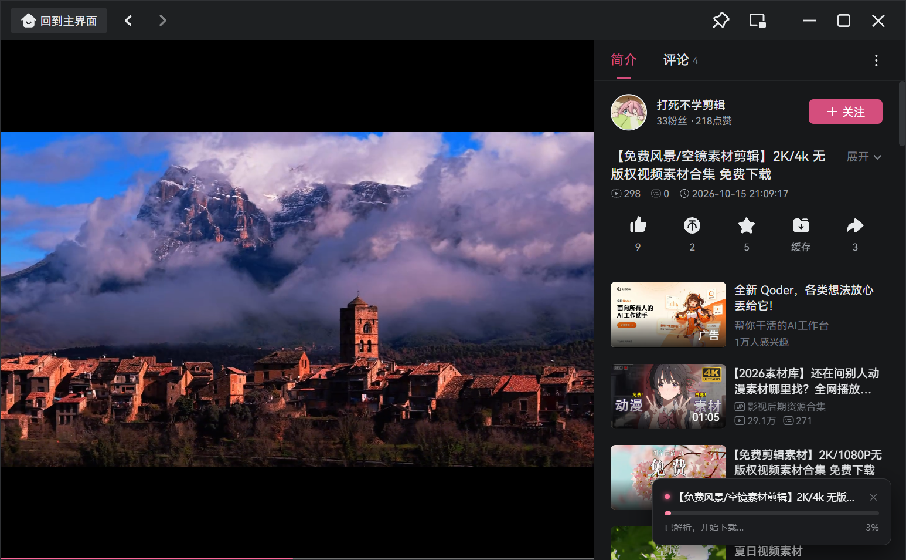
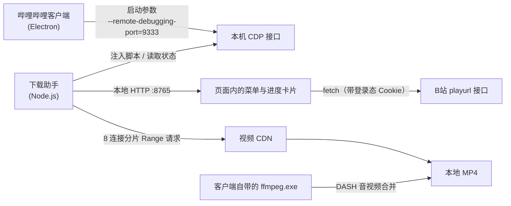

# B站 PC 客户端 · 右键下载助手

<p align="center">
  
  
  
</p>

> 给哔哩哔哩 PC 客户端加一个「右键下载」：**不修改客户端任何文件**，注入式外挂，装完就能用。
>
> 规格一眼可见 · 默认最高画质 · 多连接加速 · 下载中可取消 · 全屏可用

> [!CAUTION]
> **本项目仅供个人学习研究与离线观看之用，严禁商业使用、批量抓取与二次分发。**
> 它不破解、不绕过任何付费或会员限制，也不提供任何视频内容；清晰度上限完全取决于你自己账号的权限。
> 使用前请务必阅读 **[免责声明与使用条款](#-免责声明与使用条款)**——下载或使用即视为你已同意全部条款。
> 若你不确定自己的使用场景是否合规，请先咨询专业律师。

<p align="center">
  
</p>

<p align="center">
  <sub>▲ 真实录制的操作流程：右键弹出菜单 → 选 720P → 进度卡片（可取消）→ 完成提示</sub>
</p>

---

## ✨ 功能

| | |
|---|---|
| 🖱️ **右键即下载** | 在播放画面上点右键，弹出下载菜单，不用切窗口、不用复制链接 |
| 🎬 **一眼看清规格** | 菜单顶部直接写出这个视频的**真实清晰度 · 分辨率 · 帧率 · 码率**，并提示「本视频最高 30fps」这类上限 |
| ⬇️ **默认最高画质** | 点「下载视频」就是当前能拿到的最高档：画面流 + 声音流分开下，再用客户端自带 ffmpeg 合并 |
| 🗂 **更多清晰度（可折叠）** | `720P 秒下`（单文件、免合并）、`高清 2K`、`高清 4K` 收进二级，主菜单只留 5 行 |
| 🖼️ **高清 2K / 4K** | 源片有 2K/4K 就下**原生**；源片不够高时用 ffmpeg 插值放大到 2560×1440 / 3840×2160，文件名自动带 `[2K]` `[4K]` 标记 |
| 📋 **一键复制链接** | 菜单顶部点 BV 号或「复制」，直接把 `https://www.bilibili.com/video/BV…` 写进剪贴板 |
| 🛡️ **崩溃自愈** | 后台助手由 `守护启动.vbs` 托管：进程意外退出会在 5 秒内自动拉起，开机自启也指向它 |
| 🧾 **崩溃留痕** | `uncaughtException` / 未处理的 Promise 拒绝都会写进 `日志.txt`，不再"莫名其妙就没了" |
| ⚡ **多连接加速** | B站 CDN 对单条连接限速约 8 Mbps，本工具默认开 **8 条连接分片下载**，实测提升 **10 倍以上** |
| ⛔ **下载中可取消** | 进度卡片上有「取消」，立刻断开所有连接并删掉半成品，不留垃圾文件 |
| 🖥️ **全屏可用** | 全屏播放时菜单和进度卡片照样能用（这个坑不简单，见[技术细节](#-几个踩过的坑)） |
| 🔔 **完成不打扰** | 下完只在右下角弹一个小卡片，写清保存位置；**不会**突然弹出资源管理器打断你 |
| 📁 **自定义保存路径** | 支持 Windows 原生目录选择框，随时改 |
| 🔁 **开机自启 + 看门狗** | 客户端被别的入口重启后，自动重新注入，菜单不会"消失" |

## 📸 界面

<p align="center">
  
  
</p>

<p align="center">
  
  
</p>

## 🚀 快速开始

### 环境要求

- Windows 10 / 11
- [哔哩哔哩 PC 客户端](https://app.bilibili.com/)（本项目在 **1.19.0 / Electron 22.3.27** 上开发验证）
- [Node.js](https://nodejs.org/) **16 或更高**（客户端自带 Electron，但本工具需要独立的 Node 运行时）

### 三步用起来

```text
1. 下载本项目（或 git clone）
2. 双击  启动下载助手.bat
3. 到客户端里播放视频 → 在画面上点右键 → 下载
```

第一次启动时，脚本会自动：

- 关掉当前客户端，用带调试端口的参数重新拉起（**只加启动参数，不改任何文件**）
- 注入菜单和下载逻辑
- 在本机 `127.0.0.1:8765` 起一个本地服务处理下载

> 之后想常驻后台：双击 `安装开机自启.bat`，以后开机自动运行，无窗口、无托盘图标。
> 它会装入 `守护启动.vbs`——助手进程万一崩了/被结束了，会在 5 秒内自动重启，不用再手动开。

### 其他脚本

| 文件 | 作用 |
|---|---|
| `启动下载助手.bat` | 带控制台启动（能看到日志，适合第一次排查） |
| `静默启动.vbs` | 无窗口后台启动（只启动一次，不守护） |
| `守护启动.vbs` | **守护进程**：node 退出后自动重启（开机自启默认指向它） |
| `tools\supervisor.ps1` | **守护进程（PowerShell 版）**：健康检查 + 自动重启，开机自启指向它 |
| `tools\launcher.ps1` | **启动器（PowerShell 版）**：先确保助手在跑，再带调试端口启动客户端；桌面图标指向它 |
| `tools\restart.ps1` / `重启客户端.bat` | 一键重启客户端（卡住时用） |
| `启动哔哩哔哩.vbs` | 旧版启动器（VBScript，保留兼容；Windows 正在淘汰 VBScript） |
| `重启客户端.vbs` | **卡住/黑屏时一键恢复**：关掉所有客户端进程再重新拉起 |
| `停止下载助手.bat` | 停掉后台服务 |
| `安装开机自启.bat` | 写入启动项 |

## ⚙️ 配置

设置可以在客户端里右键 → `设置下载位置…` 里改，也可以直接编辑 `config.json`：

```json
{
  "downloadDir": "C:\\Users\\你\\Videos\\bilibili\\下载助手",
  "autoOpenFolder": false,
  "autoRestoreClient": true,
  "concurrency": 8
}
```

| 字段 | 默认值 | 说明 |
|---|---|---|
| `downloadDir` | `视频\bilibili\下载助手` | 保存目录 |
| `autoOpenFolder` | `false` | 下载完**直接弹出资源管理器**（会切窗口）。默认关闭，只弹完成卡片 |
| `autoRestoreClient` | `true` | 客户端被重启后自动恢复右键菜单（看门狗） |
| `concurrency` | `8` | 每条流的并发连接数，1~16。网络稳定可调高，遇到限流可调低 |

## 🧩 工作原理



关键点：

1. **零侵入**：不打包、不替换 `app.asar`、不改客户端二进制。只是用 Electron 官方支持的远程调试端口连上去，往页面里注入一段脚本。
2. **借用登录态**：注入的脚本在页面上下文里跑，`fetch` 自动带上 Cookie，所以能拿到和你账号一致的清晰度（登录后可达 1080P+/4K）。
3. **复用 ffmpeg**：客户端自带 `ffmpeg.exe`，1080P 以上的 DASH 音视频合并直接用它，不需要额外下载。

## ⚡ 为什么下载这么快

同一时间、同一个文件、同一台机器的对比测试：

| 下载方式 | 速度 |
|---|---|
| 单连接（最初的实现） | **0.94 MB/s**（7.9 Mbps） |
| **8 连接分片（现在的实现）** | **5 ~ 15 MB/s**，峰值 **37 ~ 101 MB/s** |

B站 CDN 对**单条 TCP 连接**做了限速，但**总带宽并不低**——把文件按字节切成 8 段并行请求，速度直接解锁。实测一个 372 MB 的视频，面板上跑到过 `101.3 MB/s`。

> 顺带排除一个常见误解：这不是你宽带的问题。同一次测试里，国际测速节点（Cloudflare）只有 `0.41 MB/s`，而 B站 多连接能到 `100 MB/s` —— 说明瓶颈在单连接限速，不在线路本身。

## 📂 目录结构

```text
.
├── server.js              # 主程序：本地 HTTP 服务、CDP 注入、看门狗、下载调度
├── lib/
│   ├── bili.js            # 下载核心：多连接分片、进度、取消、ffmpeg 合并
│   ├── cdp.js             # 极简 CDP 客户端（不依赖第三方库）
│   └── inject.js          # 注入到页面里的 UI：右键菜单、进度卡片、设置弹窗
├── tools/
│   ├── reveal.ps1         # 打开文件夹并强制置前（Windows 原生调用）
│   ├── pickfolder.ps1     # Windows 原生目录选择框
│   └── probe.js           # 探测客户端/CDP 状态
├── docs/                  # README 用图
├── 启动下载助手.bat
├── 启动哔哩哔哩.vbs
├── 守护启动.vbs
├── 静默启动.vbs
├── 停止下载助手.bat
├── 安装开机自启.bat
└── 使用说明.md             # 更详细的中文使用手册
```

## ❓ 常见问题

<details>
<summary><b>为什么只能下到 720P？</b></summary>

720P 走的是「单文件 MP4」通道，不需要合并，所以最省事。

更高的清晰度（1080P / 4K）B站 只提供 **DASH** 形式——画面和声音是分开的两条流，必须用 ffmpeg 合并。本工具支持，在菜单里选「最高画质 · 自动合并」即可，清晰度上限取决于你的账号权限。

</details>

<details>
<summary><b>2K / 4K 是"真"的吗？</b></summary>

分两种情况：

- **源片本来就有 2K/4K**（通常需要大会员权限）→ 下载的是**原生画质**，没有损失。
- **源片只有 1080P / 720P** → 用 ffmpeg 的 `lanczos` 插值 + 轻锐化放大，分辨率数字是真的（2560×1440 / 3840×2160），但**细节是算出来的，不是还原**。文件会明显变大，转码也要几分钟（实测 43 秒的片子约 1~2 分钟）。

文件名里的 `[2K]` `[4K]` 标记就是给你区分的。

</details>

<details>
<summary><b>下载完为什么不自动打开文件夹？</b></summary>

这是故意的。直接弹出资源管理器会把你的全屏画面切走，很打断观看。

默认只在客户端右下角显示完成卡片，卡片上写着**保存路径**，点了才会打开（并自动选中刚下载的文件）。想要下完就自动打开，把 `autoOpenFolder` 改成 `true`。

</details>

<details>
<summary><b>客户端用着用着卡住 / 播放器黑屏？</b></summary>

双击 **`重启客户端.vbs`**：它会关掉所有 `哔哩哔哩.exe` 进程，再通过带调试端口的入口重新拉起，几秒钟就好。

看门狗在你看视频时**不会**去动窗口（只有连续 90 秒没有可见窗口、且当前没在播放时才唤醒），所以正常观看不会被它打断。

</details>

<details>
<summary><b>桌面图标点了没反应 / 助手老是自己没了？</b></summary>

桌面上的 `哔哩哔哩` 快捷方式已经指向 `启动哔哩哔哩.vbs`：它会**先确认助手的健康接口有响应**，没有就先拉起守护进程，然后再用调试端口启动客户端。

所以只要你还从桌面图标进 B站，助手就一定会跟着起来。想还原成原来的启动方式，用同目录下备份的 `哔哩哔哩.lnk.bak-*` 覆盖回去即可。

</details>

<details>
<summary><b>B站客户端「打不开了」／双击图标没反应？</b></summary>

多半是**主窗口被关掉、但进程还在后台跑**：B站 是单实例应用，再次双击图标只会转发给已经在跑的那个实例，而它没有窗口可显示。

本工具的看门狗每 30 秒检查一次：有隐藏窗口就唤醒它；进程在、却一个正常窗口都没有，就重启客户端。所以正常情况你不用管。

想手动处理：任务管理器里结束所有 `哔哩哔哩.exe`，再打开客户端即可。

</details>

<details>
<summary><b>右键菜单又不见了（之前明明好好的）？</b></summary>

先看 `日志.txt` 最后几行，判断是哪一类：

- **最后一行是"看门狗：客户端已退出"** → 客户端重启过，助手会在它起来后自动接管，等几秒即可。
- **日志停更很久 / 没有任何新行** → 助手进程本身没了。以前这会让菜单"凭空消失"且毫无痕迹；现在装了 `守护启动.vbs`，5 秒内会自己拉起来。
- **想看它到底活着没** → 浏览器打开 `http://127.0.0.1:8765/api/health`，返回 `"ok":true` 就是正常。

</details>

<details>
<summary><b>重启客户端后右键菜单没了？</b></summary>

菜单依赖「带调试端口启动」这个条件。如果你从别的入口启动客户端（开始菜单、桌面快捷方式），端口就没了，菜单自然消失。

解决办法有两个：开启 `autoRestoreClient`（默认开），看门狗会在 10 秒内把客户端重新拉起来；或者把桌面快捷方式的参数改成带 `--remote-debugging-port=9333`。

</details>

<details>
<summary><b>下载速度忽快忽慢？</b></summary>

分片下载对 CDN 节点比较敏感，速度波动是正常的。可以调 `concurrency`：网络好可以试 12~16，被限流就降到 4。

</details>

<details>
<summary><b>安全吗？会不会动我的客户端？</b></summary>

不会。全程只做两件事：用启动参数让客户端开放调试端口，以及往页面里注入脚本。**没有修改、替换、重打包任何客户端文件**，删掉本项目就完全恢复原样。

</details>

## 🔧 几个踩过的坑

这部分对想二次开发的人有用，也是项目里最花时间的部分：

| 问题 | 现象 | 原因与解法 |
|---|---|---|
| **全屏下菜单不可见** | 菜单在 DOM 里、`getBoundingClientRect` 正常，但屏幕上没有，连 `elementFromPoint` 都点不到 | 客户端全屏用的是 **Fullscreen API**（`document.fullscreenElement = .app_player--wrap`）。按规范，全屏时浏览器**只渲染全屏元素及其子树**，挂在 `<body>` 下的浮层会被完全隐藏。解法：把浮层挂到 `document.fullscreenElement` 内部，并监听 `fullscreenchange` 自动迁移 |
| **单连接被限速** | 稳定在 0.9 MB/s，换任何 CDN 节点都一样 | CDN 对单连接限速，改成 8 连接分片后提升 10 倍以上 |
| **切换视频后下错内容** | 标题是 A，下出来是 B 的视频 | 用「最近 N 条网络请求」投票判断当前视频，切视频后旧视频的残留请求还占多数。改成**按时间窗投票**（只看最近 15 秒） |
| **`explorer.exe` 不生效** | 命令行里能打开，Node 里调没反应 | 两个坑：`/select,` 后必须跟引号包裹的完整路径；以及从后台进程启动的资源管理器**抢不到前台**。解法：改用 PowerShell 的 ShellExecute 通道，并主动 `SetForegroundWindow` |
| **`.ps1` 里的中文乱码** | PowerShell 报语法错误 | Windows PowerShell 按 ANSI 读取无 BOM 的 `.ps1`。解法：脚本保持纯 ASCII，中文全部由 Node 传参进来 |
| **注入脚本为什么不用框架** | — | 客户端页面是 B站 自己的 React 应用，注入脚本刻意不依赖任何库，也不 hook 全局对象，避免和客户端打架 |
| **客户端改版换了播放页** | 之前能用的右键，某天突然只在部分视频上有反应 | 新版客户端把一部分内容移到 `index.html#/page/…`（合集、短视频等路由）里播放，只认 `player.html` 就会漏。解法：注入覆盖客户端**所有页面**，同时只在页面里确实存在 `<video>` 时才接管右键，普通页面的右键不受影响 |
| **下载到的是别的视频** | 标题是对的，但下载到的音频/画面是另一个视频的 | 两条线索都会骗人：页面 URL 可能还停在上一个视频，而**分片投票会被客户端预加载的推荐视频带偏**（实测遇到过：URL 是 95s 的片子，投票却指向另一个）。而 `cid` 决定真正下载到的内容、`bvid` 只决定标题，配错就是"张冠李戴"。解法：① 列出全部候选（URL / 投票 / 上次解析），逐个解析；② 用**播放器实际时长**比对（容差 5%、至少 3 秒），**谁对得上用谁**；③ 全都对不上就**直接报错**让用户刷新，绝不下错；④ 标题用最终选中的 `bvid` 去 `view` 接口取，保证文件名和内容同源 |
| **`<video>.duration` 不能当铁证** | 同一个视频，`duration` 先报 208s、几秒后变 215s，导致"时长对不上"误判 | MSE 的 duration 在加载初期是**渐进值**。所以时长只用来辅助挑候选 id，**不能**否决页面 URL。改成打分制：URL 优先，时长只做参考，候选全部失败也不硬报错 |
| **改了代码但客户端还是旧行为** | 明明修好了，右键还是报旧错误；甚至**一次右键弹出两个菜单** | 注入脚本会被反复注入，旧实例的右键监听器还活着 → 新旧两个版本同时响应。解法：脚本带**版本号（内容哈希）**，服务端每 2 秒比对，版本不一致就重新注入；新脚本第一件事是调用上一个实例的 `__BDL_TEARDOWN__`，把监听器、浮层、定时器全部拆干净。没有自毁入口的更老版本，则自动重载页面清理 |
| **信息流页面下错视频** | 在「精选 / 推荐流」(`index.html#/page/selected`) 上下载，拿到的却是别的视频 | 这类页面 URL 里没有 `bvid/cid`、DOM 里也没有视频链接，而客户端请求的是 `playurl?avid=…&cid=…`（**没有 bvid**），并且后面的卡片会被**预加载**。解法：① 从脚本启动就用 `PerformanceObserver` 记录 `avid↔cid`（性能缓冲区会被上千条分片挤爆）；② 把 avid 反查成 bvid；③ 因为预加载的也在里面，**逐个查时长、只认和播放器时长对得上的那个** |
| **两个任务抢同一个文件名** | 同时下两个同名视频，其中一个取消后，另一个报 `ENOENT: .part0` | `uniquePath` 只检查"文件是否已存在"，看不到**正在下载中**的文件。解法：加一张"占用的文件名"表，任务结束时释放 |

## ⚠️ 免责声明与使用条款

> **请在使用本项目之前完整阅读本节。下载、安装或使用本项目，即视为你已阅读、理解并同意以下全部条款。如果你不同意其中任何一条，请立即停止使用并删除本项目。**

### 1. 项目性质

本项目（下称"本软件"）是一个**在本地运行的个人辅助工具**。它的工作方式是：通过哔哩哔哩 PC 客户端自身提供的调试接口，向客户端页面注入一小段辅助界面脚本，从而在播放画面上增加一个下载入口。

- 本软件**不是**哔哩哔哩官方产品，与哔哩哔哩（上海幻电信息科技有限公司）及其关联公司**没有任何隶属、合作、授权或背书关系**。
- 本软件**不是**"破解工具"，不包含任何反编译、脱壳、绕过授权或入侵他人系统的代码。
- 本软件**不修改**客户端安装目录下的任何文件（不改 `app.asar`、不改二进制、不重打包），卸载或删除本软件后客户端即恢复原样。

### 2. 允许的用途

- 个人学习、技术研究与交流（例如了解 Electron 调试协议、分片下载、DASH 合并的实现方式）。
- 下载**你自己账号本来就有权观看**的内容，用于**个人离线观看**（例如在无网络的旅途中观看）。

### 3. 明确禁止的用途

- ❌ 任何形式的**商业使用**，包括但不限于出售、出租、作为付费服务的一部分。
- ❌ **批量抓取 / 爬取**整站或大量视频，对平台服务器造成异常压力。
- ❌ 将下载的内容**二次分发**：上传到其他视频平台、网盘、社群，或用于剪辑后发布（除非你已获得权利人授权）。
- ❌ 去除水印、去除版权标识、**绕过付费墙、会员限制或 DRM 加密**。
- ❌ 用于侵犯他人隐私、肖像权、名誉权或其他合法权益的目的。
- ❌ 任何违反所在地法律法规、或违反平台用户协议的行为。

### 4. 关于"不绕过任何限制"

本软件**不破解、不解密、不绕过**任何付费内容、会员专享、DRM 或区域限制。

它做的事情本质上只有一件：**复用你已登录账号的既有权限**，把你"本来就能在客户端里正常观看"的内容保存到本地文件。清晰度上限、能否下载，完全取决于你账号本身的权限——普通账号拿不到 4K，本软件也拿不到。

### 5. 版权归属

- 你通过本软件获取的视频、音频、字幕、封面等**一切内容，其著作权及相关权利均归原作者和平台所有**，本软件不对其主张任何权利。
- 依据《中华人民共和国著作权法》第二十四条，为个人学习、研究或欣赏而使用他人已发表作品，可以构成**合理使用**；但请注意：**"合理使用"仅限于你自己使用，不等于你可以传播**。
- 若你需要将内容用于任何公开或商业场景，**必须自行取得权利人的明确授权**。

### 6. 不提供、不托管任何内容

本软件**不提供、不存储、不上传、不分发**任何视频内容，也不内置任何解析接口、签名算法或内容源。

所有内容均来自：① 你本机安装的官方客户端；② 你自己账号的访问权限。本软件只是一个"把你看到的东西存到本地"的搬运工。

### 7. 使用风险

使用任何第三方工具操作官方客户端都存在不可预知的风险，包括但不限于：

| 风险 | 说明 |
|---|---|
| 账号风险 | 平台可能将非常规的访问行为判定为异常。本软件未做任何伪装、反检测或高频请求优化，**不建议高频、长时间、大批量使用** |
| 功能失效 | 客户端更新后调试接口或页面结构可能变化，导致菜单消失或下载失败，需要重新适配 |
| 客户端异常 | 极端情况下（如强制结束进程）可能导致客户端配置或缓存异常，通常重启即可恢复 |
| 数据丢失 | 下载中断、磁盘写满、路径被占用等情况可能产生不完整文件 |

**请自行评估上述风险并承担相应后果。建议首次使用时先备份重要的客户端配置。**

### 8. 无担保

本软件按**"现状"（AS IS）**提供，不附带任何明示或默示的担保，包括但不限于对**适销性、特定用途适用性、无侵权、无错误、不中断**的担保。

作者不承诺本软件能正常工作、不会损坏你的文件、或适用于任何特定目的。

### 9. 责任限制

在适用法律允许的最大范围内，**作者及贡献者不对因使用或无法使用本软件而产生的任何直接、间接、偶然、特殊、惩罚性或后果性损害承担责任**，包括但不限于：

- 数据丢失或文件损坏
- 账号被限制、封禁或处罚
- 利润损失、业务中断
- 任何法律纠纷、索赔或诉讼
- 第三方对你提出的任何主张

即使作者已被告知上述损害的可能性，本条款依然适用。

### 10. 合规责任

- 你应**自行确保**你的使用行为符合你所在国家/地区的法律法规（包括但不限于著作权法、网络安全法）以及平台用户协议。
- 因使用本软件产生的**全部法律责任由使用者本人承担**，与作者及贡献者无关。
- 若你不确定自己的使用场景是否合规，**请先咨询专业律师**，不要"先用了再说"。

### 11. 权利通知与下架

本项目尊重他人的知识产权。**如果你是权利人或其授权代表**，认为本项目的内容或实现方式侵犯了你的合法权益，请通过仓库的 **Issue** 联系说明情况（请附上权利证明），我会在核实后尽快处理：删除相关内容、调整实现方式，或直接归档仓库。

### 12. 条款的变更与解释

- 作者保留随时修改本声明的权利，修改后直接更新于本文件，**不另行单独通知**。你继续使用即视为接受更新后的条款。
- 若本声明中的任何条款被有管辖权的机构认定为无效或不可执行，该条款将在最小必要范围内被调整或删除，**其余条款的效力不受影响**。
- 本声明未尽事宜，以相关法律法规为准。

---

> **本声明不构成法律意见**，也无法完全免除你的法律责任。它只是一份尽可能清晰的使用边界说明。如果你的使用场景涉及商业、公开传播或不确定是否合规，请务必咨询专业律师。

## 📄 License

[MIT](LICENSE)

---

<p align="center">
  <sub>如果这个项目帮到了你，欢迎点个 ⭐ Star</sub>
</p>
